# Infrastructure as Code with AWS CloudFormation, GitHub Actions and OIDC

This project deploys a small web stack on AWS straight from Git. A CloudFormation template describes a new VPC with a public subnet, an internet gateway and routing, a security group, and an Ubuntu 24.04 EC2 instance that installs Nginx on first boot. When I push a change to the template or the workflow on `main`, GitHub Actions validates the template and deploys it. The first push created the stack, and the second push updated that same stack in place.

GitHub signs in to AWS through **OpenID Connect (OIDC)** and gets short-lived credentials, so there are no AWS access keys in this repository or in GitHub Secrets.

**Tech stack:** AWS CloudFormation · GitHub Actions · GitHub OIDC + AWS STS · AWS IAM · Amazon EC2 (Ubuntu 24.04 LTS) · Amazon VPC · Nginx · AWS CLI

## Results at a glance

| What | Result |
| --- | --- |
| Region | `us-west-2` (US West, Oregon) |
| Stack | `bongodev-github-iac-dev`, 9 resources |
| First push (`a13aadd`) | Workflow run #1 passed. The deploy step created the stack in **1 m 7 s**. Stack reached `CREATE_COMPLETE`. |
| Second push (`af40d0c`) | Workflow run #2 passed. The stack went from `UPDATE_IN_PROGRESS` to `UPDATE_COMPLETE` in **8 seconds** (10:37:49 to 10:37:57). |
| EC2 instance | `t3.micro`, Ubuntu 24.04, `i-00d9401d98a79bb9f`. Only this resource changed during the update, and it was updated in place, not replaced. |
| Website | Nginx page "Hello from bongoDev!" with `Environment: dev`, served over HTTP |
| Cleanup | Workflow disabled, stack deleted, IAM role, policy and OIDC provider removed |

I never clicked **Create stack** or **Launch instance** in the AWS console. The pipeline did the deployment.

> **Screenshots:** account IDs, ARNs and the numeric GitHub IDs are hidden. Times are local time (UTC+6).

## Architecture

```text
  My laptop (VS Code)
        |
        |  git push origin main
        v
  GitHub repo: Yeash1213/bongodev-cloudformation-github-actions
        |
        |  push to main that changes cloudformation.yaml or deploy.yml
        v
  GitHub Actions runner (ubuntu-latest)
        |  1. checkout the repository
        |  2. get an OIDC token from GitHub
        |  3. AssumeRoleWithWebIdentity  ---->  IAM role: bongodev-github-iac-deploy-role
        |     <----  temporary credentials      (trusts only this repo's main branch)
        |  4. aws cloudformation validate-template
        |  5. aws cloudformation deploy   (create or update)
        |  6. print the stack outputs
        v
  CloudFormation stack: bongodev-github-iac-dev  (us-west-2)
        |
        +--> VPC 10.42.0.0/16
        |      +--> public subnet 10.42.1.0/24 --> route table --> internet gateway
        |      +--> security group: inbound TCP 80 only (no SSH)
        |
        +--> EC2 t3.micro, Ubuntu 24.04 LTS, IMDSv2 required
                 |
                 |  UserData on first boot: apt-get install nginx, write index.html
                 v
           http://<public-ip>  -->  "Hello from bongoDev!"
```

## What the stack creates

Defined in [`cloudformation.yaml`](cloudformation.yaml):

| Resource | Logical ID | Details |
| --- | --- | --- |
| VPC | `DemoVPC` | `10.42.0.0/16`, DNS support and hostnames on |
| Internet gateway | `InternetGateway`, `GatewayAttachment` | Attached to the VPC |
| Public subnet | `PublicSubnet` | `10.42.1.0/24`, public IP on launch |
| Routing | `PublicRouteTable`, `DefaultRoute`, `PublicRouteAssociation` | `0.0.0.0/0` to the internet gateway |
| Security group | `WebSecurityGroup` | Inbound TCP 80 only |
| EC2 instance | `UbuntuNginxServer` | `t3.micro`, Ubuntu 24.04, Nginx installed by UserData, tags `Name`, `Environment`, `Course` |

The Ubuntu AMI is not hardcoded. The template reads Canonical's public SSM parameter, so it always gets the current Ubuntu 24.04 image for the Region. Outputs: `WebsiteURL`, `InstanceId`, `PublicIPAddress`, `VpcId`.

Set up once, outside the stack:

| Item | Name / value |
| --- | --- |
| IAM OIDC identity provider | `token.actions.githubusercontent.com`, audience `sts.amazonaws.com` |
| IAM policy (customer managed) | `bongodev-github-iac-lab-policy` |
| IAM role | `bongodev-github-iac-deploy-role` (max session 1 hour) |
| GitHub repository variables | `AWS_ROLE_ARN`, `AWS_REGION` = `us-west-2` |

## How OIDC replaces access keys

The role's trust policy only accepts a GitHub token when two conditions match exactly:

```json
"Condition": {
  "StringEquals": {
    "token.actions.githubusercontent.com:aud": "sts.amazonaws.com",
    "token.actions.githubusercontent.com:sub": "repo:Yeash1213@<OWNER_ID>/bongodev-cloudformation-github-actions@<REPO_ID>:ref:refs/heads/main"
  }
}
```

1. **`aud`** must be `sts.amazonaws.com`, so a token made for another service is rejected.
2. **`sub`** must be this repository on the `main` branch. Because the repo was created after July 15, 2026, GitHub puts the numeric owner ID and repo ID in the subject. The IAM console wizard generates the older name-only format, so I replaced its trust policy with the one from [`iam/trust-policy-new-repos-2026.json`](iam/trust-policy-new-repos-2026.json).
3. The condition uses `StringEquals` with no wildcards, so other branches, forks and other repositories can't assume the role.

The deploy policy ([`iam/deployment-policy-lab.json`](iam/deployment-policy-lab.json)) allows CloudFormation change-set actions, reading the Ubuntu SSM parameter, and the EC2/VPC actions this stack needs. It has no IAM permissions and no `cloudformation:DeleteStack`, so the pipeline can deploy but can't delete the environment or give itself more access.

---

## Step-by-step evidence

### 1. AWS IAM setup

Added the GitHub OIDC identity provider.

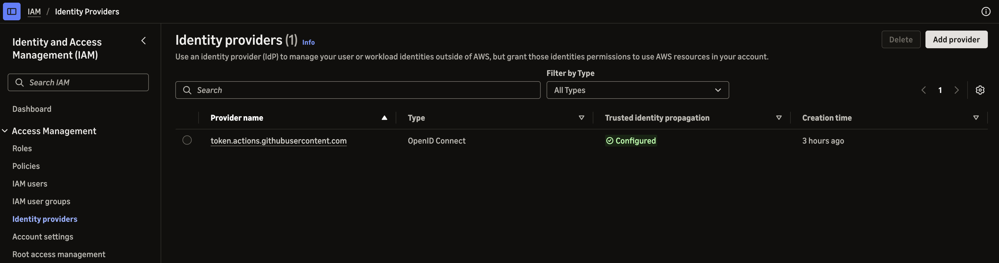

Created the customer-managed policy `bongodev-github-iac-lab-policy`. It allows only CloudFormation, EC2 and Systems Manager.

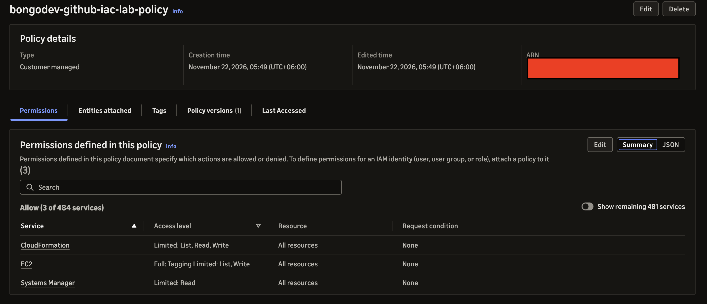

Created the role `bongodev-github-iac-deploy-role` and attached the policy.

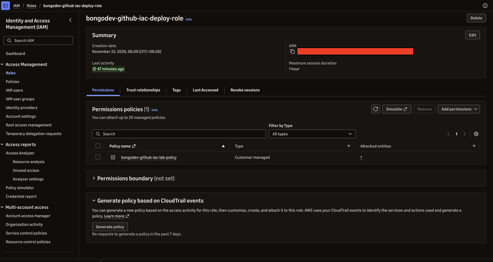

Replaced the trust policy with the new-format subject (owner and repo IDs, `main` branch only).

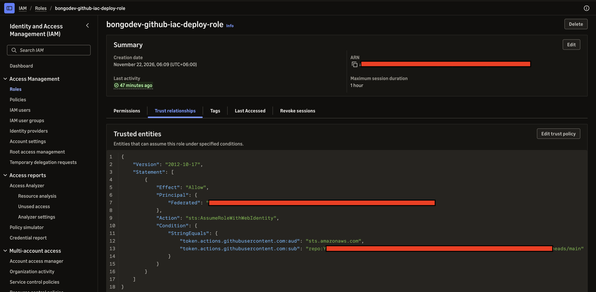

Added the two repository **variables** in GitHub. No secrets were created.

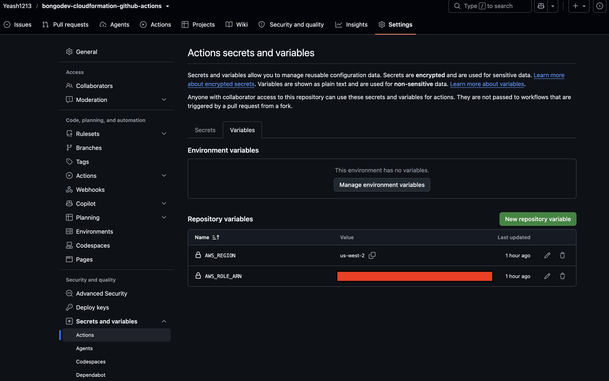

### 2. First push: the pipeline creates the stack

Pushed the project to `main` with the commit `Add IaC and GitHub Actions automation` (`a13aadd`).

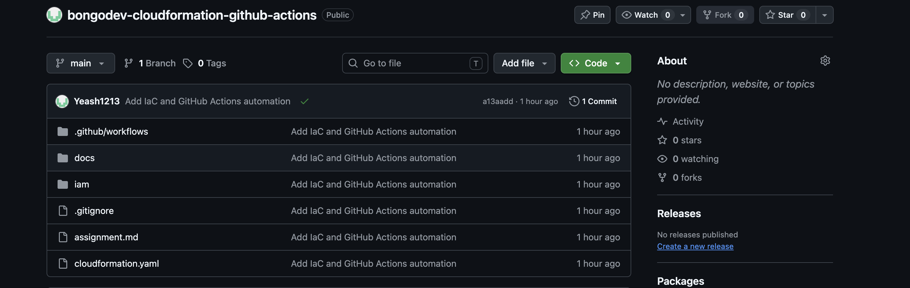

Workflow run #1 started on its own and every step passed. The job took 1 m 19 s, and the deploy step took 1 m 7 s.

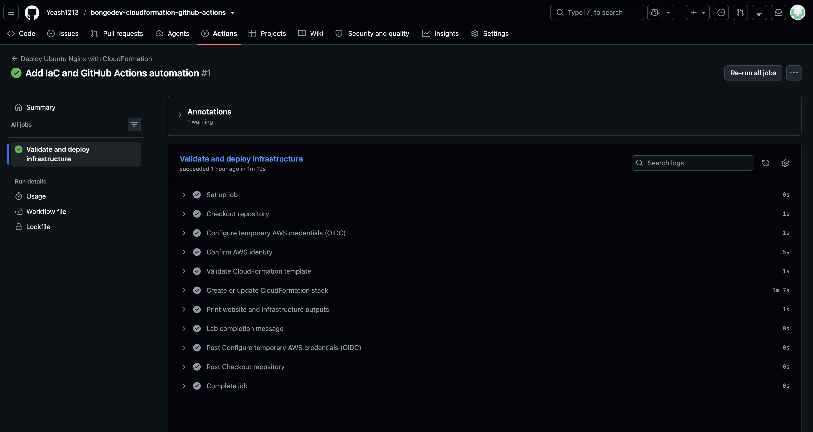

The stack `bongodev-github-iac-dev` reached **CREATE_COMPLETE** (created 2026-11-22 08:41:26).

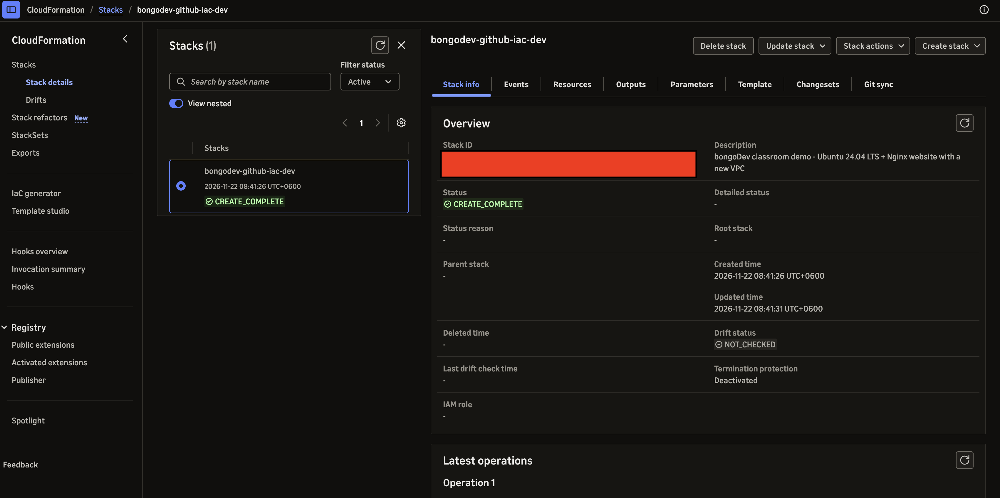

All 9 resources were created.

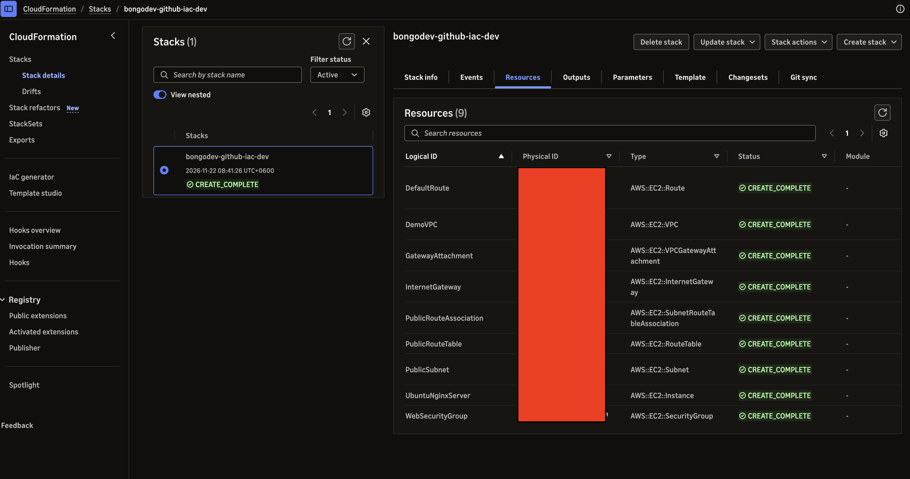

The website loaded from the instance's public IP over HTTP.

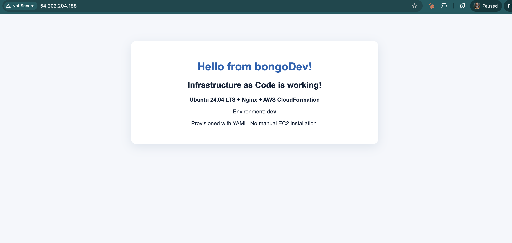

### 3. Second push: in-place update

Changed one line in `cloudformation.yaml`: the EC2 `Course` tag from `bongoDev-DevOps` to `bongoDev-DevOps-Homework-V2`. Commit `af40d0c`.

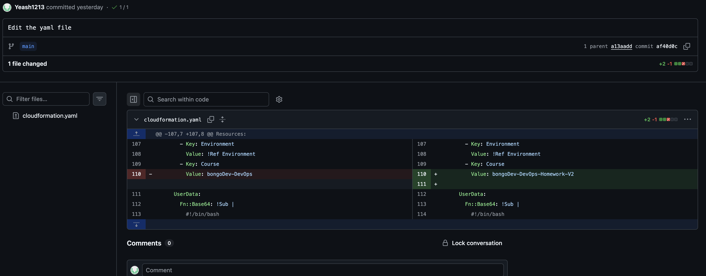

Workflow run #2 started on its own and passed in 48 s.

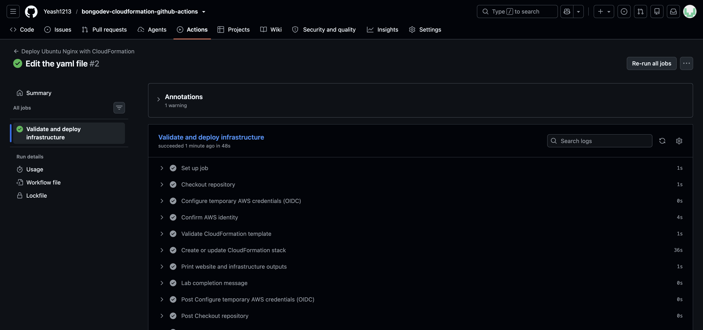

Both runs were triggered by pushes to `main`.

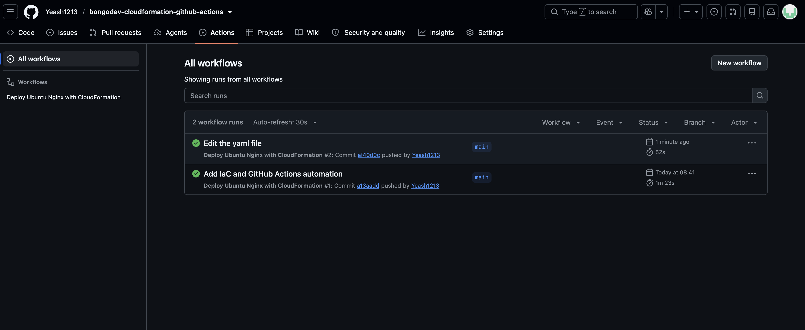

The events show the **same stack** updating. Only `UbuntuNginxServer` changed (`UPDATE_IN_PROGRESS` at 10:37:52, `UPDATE_COMPLETE` at 10:37:55), and the stack finished at 10:37:57.

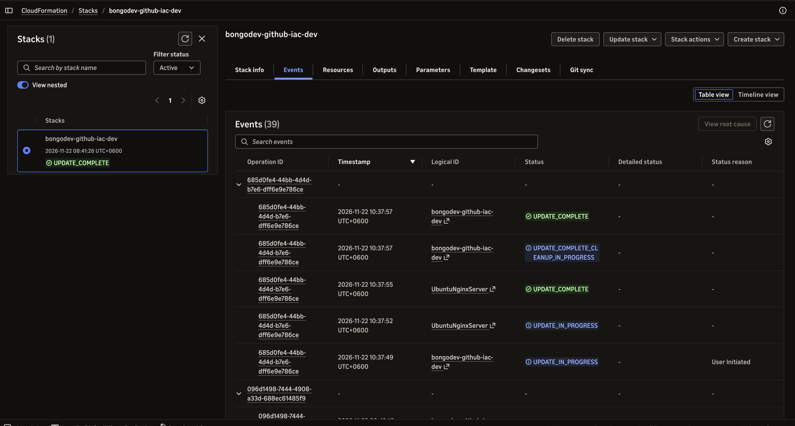

In the Resources tab, the instance shows `UPDATE_COMPLETE` while the other 8 resources stay `CREATE_COMPLETE`, so nothing was created or replaced.

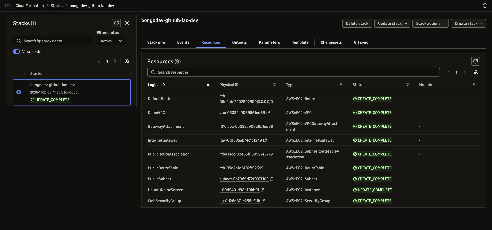

The running instance `i-00d9401d98a79bb9f` now has `Course = bongoDev-DevOps-Homework-V2`.

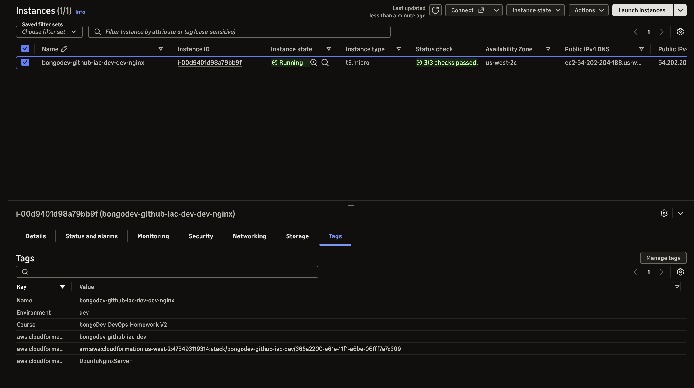

### 4. Cleanup

1. Disabled the workflow first, so a later push can't recreate the stack.

   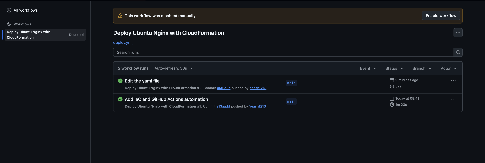

2. Deleted the stack from the CloudFormation console with my own permissions. Deleting the stack removes all 9 resources, including the EC2 instance and the VPC.

   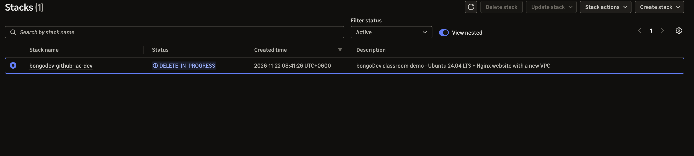

3. Deleted the GitHub OIDC identity provider, since nothing else in the account used it.

   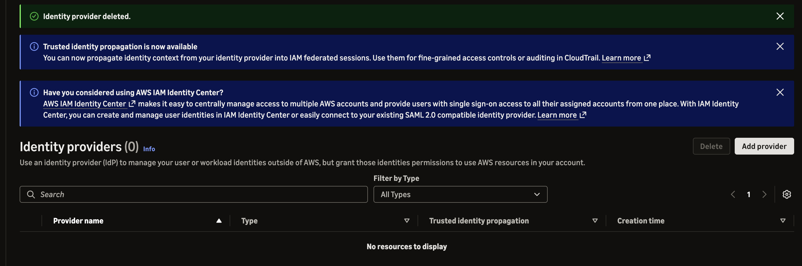

4. Deleted the deploy policy `bongodev-github-iac-lab-policy`.

   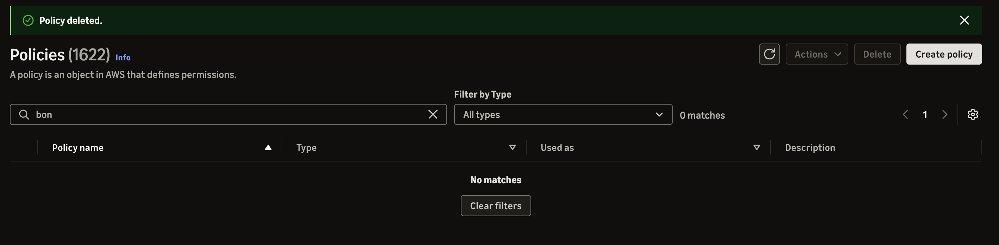

---

## Homework questions

1. **What is the difference between GitHub Actions and AWS CloudFormation?**
   GitHub Actions is the automation. It reacts to a push and runs the steps in `deploy.yml`. CloudFormation is the provisioning engine. It reads the template as the desired state and creates, updates or deletes AWS resources until the stack matches it.

2. **Why can a `git push` deploy infrastructure without anyone logging into the AWS console?**
   The workflow signs in to AWS as the IAM role using the OIDC token GitHub gives the job, then runs `aws cloudformation deploy`. Everything a person would click in the console is already written in the template.

3. **What does OIDC do, and why is it safer than committing AWS access keys?**
   OIDC lets AWS trust tokens that GitHub signs. AWS STS checks the token against the role's trust policy and returns temporary credentials that expire within an hour. There is no long-lived key that could leak, and only this repo's `main` branch can use the role.

4. **On a second push, why is the existing stack updated instead of creating a new one?**
   The workflow always uses the same stack name, `bongodev-github-iac-dev`. `aws cloudformation deploy` sees that the stack already exists, builds a change set with only the differences, and applies it. A tag change can be applied in place, so the instance was kept.

5. **Is "CloudFormation stack creation complete" always the same as "Nginx ready"? Why not?**
   No. CloudFormation marks the instance complete once EC2 reports it running. The UserData script that installs Nginx runs after boot and takes another minute or two. The template has no `CreationPolicy` or `cfn-signal`, so CloudFormation does not wait for it.

6. **Why does this homework update the EC2 tag instead of changing the webpage HTML?**
   UserData only runs on the first boot. Editing the HTML in the template would not change the page on the running instance. A tag is metadata that updates in place and is easy to check in the console.

7. **What should happen to AWS resources when you have finished the assignment?**
   Delete them to avoid charges: disable the workflow, delete the stack, confirm the instance and VPC are gone, then remove the IAM role, policy and (if unused) the OIDC provider.

## What I learned

1. The AWS console's role wizard writes the old name-only OIDC subject. New GitHub repositories need the format with numeric owner and repo IDs, otherwise `AssumeRoleWithWebIdentity` is denied.
2. GitHub **variables** are the right place for the role ARN and Region, because neither is a secret.
3. The `paths` filter in the workflow means README or screenshot commits don't trigger a deployment.
4. Teardown order matters: disable the workflow before deleting the stack.

## Repository layout

```text
.
├── README.md                      this file
├── assignment.md                  original homework instructions
├── cloudformation.yaml            VPC, subnet, routing, security group, EC2 + Nginx
├── .github/workflows/deploy.yml   OIDC sign-in, validate, deploy, print outputs
├── iam/
│   ├── deployment-policy-lab.json         deploy role permissions
│   ├── trust-policy-new-repos-2026.json   trust policy with numeric IDs
│   └── trust-policy-legacy-repos.json     trust policy for older repos
└── screenshots/                   evidence used above
```

## Credits

The CloudFormation template, workflow and IAM templates came from the bongoDev DevOps course starter files. I set up the GitHub repository, the OIDC trust between GitHub and AWS, the IAM role and policy, ran both deployments, verified the results and cleaned everything up.
